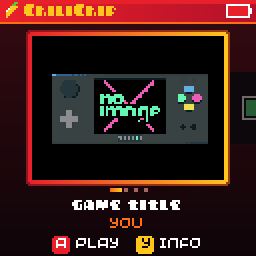
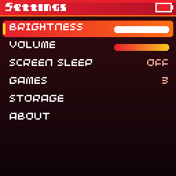
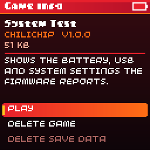

# ChiliChip OS

ChiliChip OS is what runs on the VGC Zero when you switch it on. It has three parts:

* **The loader**, system firmware in the first 256 KB of flash. It starts the console, provides the USB drive, installs games, runs them, and draws the system menu.
* **The home screen** (`vgc-os`, titled "ChiliChip OS"), itself a `.blit` with category `launcher`. It lists the installed games and holds the settings.
* **Your games**, as many `.blit` files as fit in flash.

## The home screen

* A status bar along the top shows the battery level, and a plug icon while USB is connected.
* The carousel shows one cover per game: the selected game's splash image large in the middle, its neighbours smaller at the edges. **Left** and **right** scroll, **A** plays.
* Games that have never been played come first, so new installs show up at the front, then the rest from most recently played.
* **Y** opens the game's info page: author, version, size and description, with **Play**, **Delete game** and **Delete save data**. Deleting a game that has saves asks whether to delete them too; **B** keeps them.
* The last tile, or **MENU**, opens **Settings**: brightness, volume, screen sleep, the games list with sizes, storage used and free, and **About** with the OS version, firmware version and serial number.

A game's cover is its `splash` image from `metadata.yml`, ideally 128×96. Games without one get a coloured card with their title. See [Metadata and the home screen](../guides/metadata.md).

## Installing games

Plug the console into a computer while the home screen is showing and a drive named **CHILICHIP** appears (the USB device shows as "ChiliChip Console"). Copy one or more `.blit` files to the top of the drive, then eject it or unplug the cable. The console installs each game with a progress bar, deletes the installed copies from the drive, and returns to the home screen. Files still on the drive at power-on are installed the same way.

* A new build of an installed game (same title and author) replaces the old one. Saves are kept.
* A file that is already installed is just removed from the drive.
* Files that fail stay on the drive, with a message for each: "Not a ChiliChip game" (not a `.blit`, or built for another device), "Needs a system update" (built for a newer API than the loader), "File damaged" (truncated, or its checksum doesn't match) or "Not enough space".
* While a game is running the drive is read-only, so the computer can't change files the game has open.
* Nothing is installed while the computer still has the drive mounted, because it caches the drive's contents. Until you eject, the home screen can still start a `.blit` straight from the drive.

`32blit install game.blit` over USB serial still works too.

## The system menu

Press **HOME** briefly in a game to pause it and open the system menu:

* **Resume**
* **Volume** and **Brightness**: left and right change them
* **Battery**: level and voltage
* **Quit to home**

Up and down pick an item, A selects, and B or HOME resumes. The menu doesn't open over the home screen itself.

Holding **HOME** for a second quits straight to the home screen. Both ways of quitting call the game's [`on_quit`](../api/saves.md#saving-when-the-player-quits) first, so it can save. Holding HOME waits for the game to finish its current frame; if the game is stuck for two more seconds, the loader quits without saving.

## Settings

Brightness (0–15, the panel's contrast), volume (0–100 %) and screen sleep are stored in `.system/settings.bin` on the USB drive. The loader applies them to every game, so games need no code for them. Standalone `.uf2` builds read the same file.

Games can read the settings, the battery and the USB state through the [System API](../api/system.md).

## Screen sleep

**Settings → Screen sleep** turns the screen off after 1, 2, 5 or 10 minutes without a button press (Off by default). The loader dims the panel 10 seconds before the timeout, then switches it off. Any button turns it back on. While dimmed, that press also reaches the game; while the screen is off, it only wakes the screen.

Games and music keep running while the screen is off, and an install in progress keeps the screen on.

## Battery

The loader reads the battery on GPIO 29 four times a second and smooths it. The percentage curve and the ÷3 divider in `BATTERY_DIVIDER` are inferred from the board maker's demos and still need measuring against a multimeter, so treat the percentage as approximate. "USB connected" means a computer has enumerated the console; a charger alone doesn't count.

## Updating the home screen

The home screen is a `.blit` like any game: copy `vgc-os.blit` onto the drive to update it. Installing a launcher removes any other installed launcher, so it replaces the stock 32blit launcher, and copying `launcher.blit` back swaps them again.

The system menu, the install screens and the "Deleting game" box are drawn by the loader with the same look as the home screen, from `launcher-shared/theme.hpp`.
