# ChiliChip OS

ChiliChip OS is what runs on the chilichip console when you switch it on. It has three parts:

* **The loader**, system firmware in the first 256 KB of flash. It starts the console, provides the USB drive, installs games, runs them, and draws the system menu.
* **The home screen** (`vgc-os`, titled "ChiliChip OS"), itself a `.blit` with category `launcher`. It lists the installed games and holds the settings.
* **Your games**, as many `.blit` files as fit in flash.

## The home screen

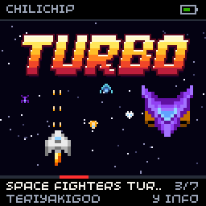
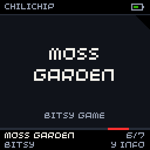
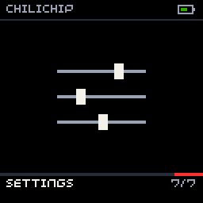
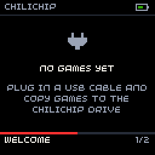

The look follows the small-screens rules of the [chilichip design system](https://github.com/chili-chip/chilichip-brand): a black background, bone text and one red thing per screen, which shows where you are.

| Rows | What |
| --- | --- |
| 0 to 12 | Status bar: "CHILICHIP" on the left, the battery on the right, and a plug while a computer is connected. Then a 1 px line. |
| 13 to 108 | The cover, 128×96, drawn 1:1 and not stretched |
| 109 to 110 | Position bar: a red mark that shows where you are in the row of tiles |
| 112 to 119 | The title on the left, "3/7" on the right |
| 120 to 127 | The author on the left, "Y INFO" on the right |

* **Left** and **right** slide to the next cover in 150 ms. **A** plays.
* A title that doesn't fit is cut with "..". After 1 s it scrolls to its end at 30 px/s, waits 1 s and starts again.
* Games that have never been played come first, so new installs show up at the front, then the rest from most recently played.
* A game without a cover gets a title card: its title at 2×, and "NO COVER", or the app that plays it for files such as Bitsy games ("BITSY GAME").
* With no games, the first tile says to copy games to the CHILICHIP drive.
* The last tile, or **MENU**, opens **Settings**.

A game's cover is its `splash` image from `metadata.yml`. Make it 128×96 so it shows sharp; a bigger one is scaled down. See [Metadata and the home screen](../guides/metadata.md).

## Game info

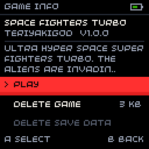
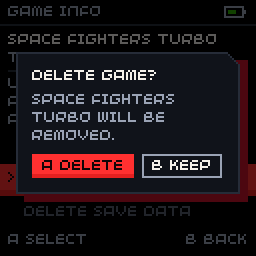

**Y** on a game opens its info: title, author and version, three lines of the description, then **Play**, **Delete game** (with its size) and **Delete save data**. "Delete save data" is grey when the game has none. Deleting a game that has saves asks whether to delete them too; **B** keeps them.

Dialogs are a panel with a hard shadow and one cut corner. **A** is always the red button.

## Settings

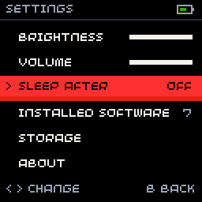
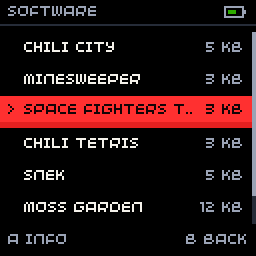
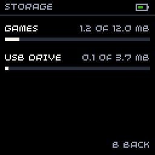
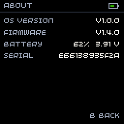

| Row | What it does |
| --- | --- |
| Brightness | 0 to 15, the panel's contrast. Left and right change it. |
| Volume | 0 to 100 %, in steps of 10 |
| Sleep after | Off, 1, 2, 5 or 10 minutes (see [Screen sleep](#screen-sleep)) |
| Installed software | Games, the files that apps play (such as Bitsy games) and the apps, with sizes. **A** opens a game's info, where you can delete it. |
| Storage | Flash used by games, and the USB drive, each with a bar |
| About | OS version, firmware version, battery and serial number |

The hint line at the bottom says what the buttons do: "< > CHANGE" on rows you change, "A OPEN" on rows that open a page.

## Installing games

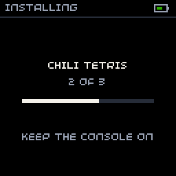

Plug the console into a computer while the home screen is showing and a drive named **CHILICHIP** appears (the USB device shows as "ChiliChip Console"). Copy one or more `.blit` files to the top of the drive, then eject it or unplug the cable. The console installs each game with a progress bar, deletes the installed copies from the drive, and returns to the home screen. Files still on the drive at power-on are installed the same way.

* A new build of an installed game (same title and author) replaces the old one. Saves are kept.
* A file that is already installed is just removed from the drive.
* Files that fail stay on the drive, with a message for each: "Not a ChiliChip game" (not a `.blit`, or built for another device), "Needs a system update" (built for a newer API than the loader), "File damaged" (truncated, or its checksum doesn't match) or "Not enough space".
* While a game is running the drive is read-only, so the computer can't change files the game has open.
* Nothing is installed while the computer still has the drive mounted, because it caches the drive's contents. Until you eject, the home screen can still start a `.blit` straight from the drive.

`32blit install game.blit` over USB serial still works too.

## Apps that play files

Some apps play files rather than being games themselves, such as citsy, which plays Bitsy games (`.bitsy`), and Chili Beat, which plays `.beat` games. Both come preinstalled in the factory image (see [Flashing](flashing.md#handler-apps-in-the-factory-image)). An app like this has `category: handler` and lists the extensions it plays in `filetypes` (see [Metadata and the home screen](../guides/metadata.md#apps-that-play-files)). Other handler apps install like any game. The home screen then:

* hides the app itself. It is listed in **Settings → Installed software**, where it can be deleted. Deleting it removes its file cards too;
* shows a card for every file with one of its extensions, at the top of the USB drive or one folder down (for example `bitsy-games/`). The card is titled with the file name, and the app's title shows as the author. These files are also listed in **Settings → Installed software**, and deleting one there (or from its info on the home screen) removes the file from the drive;
* starts the app with that file when you pick the card. When the app is done, it returns to the home screen.

The cards only exist while the app is installed: delete the app and its files stay on the drive but leave the home screen, and the loader refuses to start a file that no installed app plays.

So to add Bitsy games, copy the `.bitsy` files into a folder on the CHILICHIP drive while the home screen is showing, then eject. The installer only picks up `.blit` files, so other files stay where you put them. **Delete game** on a file's info page deletes the file from the drive.

## The system menu

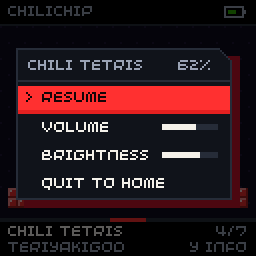

Press **HOME** briefly in a game to pause it and open the system menu. It shows the game's title and the battery level on top, then:

* **Resume**
* **Volume** and **Brightness**: left and right change them
* **Quit to home**

Up and down pick an item, A selects, and B or HOME resumes. The menu doesn't open over the home screen itself.

Holding **HOME** for a second quits straight to the home screen. Both ways of quitting call the game's [`on_quit`](../api/saves.md#saving-when-the-player-quits) first, so it can save. Holding HOME waits for the game to finish its current frame; if the game is stuck for two more seconds, the loader quits without saving.

## Where settings are kept

Brightness, volume and sleep are stored in `.system/settings.bin` on the USB drive. The loader applies them to every game, so games need no code for them. Standalone `.uf2` builds read the same file.

Games can read the settings, the battery and the USB state through the [System API](../api/system.md).

## Screen sleep

**Settings → Sleep after** turns the screen off after 1, 2, 5 or 10 minutes without a button press (Off by default). The loader dims the panel 10 seconds before the timeout, then switches it off. Any button turns it back on. While dimmed, that press also reaches the game; while the screen is off, it only wakes the screen.

Games and music keep running while the screen is off, and an install in progress keeps the screen on.

## Battery

The loader reads the battery on GPIO 29 four times a second and smooths it. GPIO 29 sees VSYS through a ÷3 divider (`BATTERY_DIVIDER`), and VSYS sits one Schottky diode below the battery, so the loader adds that diode's drop back (`BATTERY_OFFSET_MV`, 300 mV). The drop varies a little with load, so treat the percentage as approximate. With USB power plugged in, VSYS comes from USB instead and the battery reads full. "USB connected" means a computer has enumerated the console; a charger alone doesn't count.

## Updating the home screen

The home screen is a `.blit` like any game: copy `vgc-os.blit` onto the drive to update it. Installing a launcher removes any other installed launcher, so it replaces the stock 32blit launcher, and copying `launcher.blit` back swaps them again.

The system menu, the install screens and the "Deleting game" box are drawn by the loader with the same look as the home screen.

## How the look is built

Both the home screen and the loader draw with `launcher-shared/theme.hpp`:

| Part | Function | Size |
| --- | --- | --- |
| Status bar | `draw_status_bar(title)` | 12 px, then a 1 px line |
| List | `draw_list(title, rows, selected, hint_left, hint_right)` | Six 16 px rows from y = 16, a scroll bar when there are more |
| Row | `draw_row(rect, row, selected)` | The selected row is red with a 3 px shade strip, a `>` marker and dark text |
| Bar | `draw_bar(rect, value, max)` | A 3 px line |
| Panel | `draw_panel(rect)` | `surface` fill, 1 px line, hard shadow 4 px down and right, 6 px cut corner |
| Dialog | `draw_dialog(title, detail, yes, no)` | A panel with a red A button and an outlined B button |
| Hint line | `draw_hints(left, right)` | The last 12 px |
| Scrolling text | `draw_scrolling_text(state, text, rect)` | Cut with "..", then scrolls (see above) |

The colours come from `launcher-shared/chilichip.hpp`, a copy of the design system's generated token file. Copy it again when the tokens change.

The layout maths (text width, cutting, scrolling, list and position bars, the slide) is in `launcher-shared/layout.cpp` and has a host test, `launcher-layout-test`, that runs with `ctest` on desktop builds.
