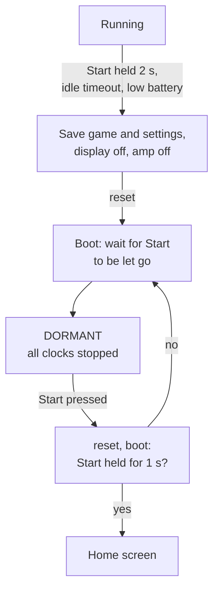

# Sleep

Board v3.0.0 has no power switch. The console sleeps instead: everything that draws power turns off, and the RP2350 stops all its clocks. This page covers `chilichip_vgc` and `chilichip_vgc_tft`. Board v1.1.4 keeps its switch and has no sleep mode.

## Using it

| To | Do |
| -- | -- |
| Sleep | hold **Start** for 2 seconds, in a game or on the home screen |
| Wake | hold **Start** for 1 second. The screen stays black while you hold it, then the home screen starts. |

A running game quits before the console sleeps, the same as quitting to home: its [`on_quit`](../api/saves.md#saving-when-the-player-quits) runs first, so it can save. There is no suspend.

The console also goes to sleep by itself:

| When | Details |
| ---- | ------- |
| **Settings → Screen sleep** time passes with no button pressed | The screen dims 10 seconds before. Not while a computer has the USB drive open: then only the screen turns off, as before. |
| The battery stays below 3.45 V for 10 seconds | Before the battery's protection cuts the power, so saves are safe (`SLEEP_BATTERY_MV`). |

A short press of Start while asleep does nothing: the console checks the button, finds it let go, and sleeps again.

## What turns off

| Part | How |
| ---- | --- |
| Display | display-off command, then its reset line held low. On the TFT version the backlight follows the reset line, so it turns off too ([vgc-zero-hardware #41](https://github.com/chili-chip/vgc-zero-hardware/issues/41)). |
| Amplifier | `AUDIO_ENABLE_PIN` (AUDIO_MODE) low |
| Radio | `RADIO_POWER_PIN` (WL_ON) low |
| Utility module | nothing to do: the IMU and the haptic driver are in power-down from their own reset, as no driver turns them on yet |
| RP2350 | DORMANT: every clock stopped, woken by Start going low |
| USB | gone while asleep. Charging still works: the charger is on the RP2350-Plus. |

The RTC keeps time while asleep, as it runs from VSYS.

## How it works

Going to sleep resets the chip, and so does waking. Nothing from the game, the USB stack or the second core is left over, and the loader starts clean. The step is kept in a watchdog scratch register, which survives the reset.



| File | Does |
| ---- | ---- |
| `32blit-pico/sleep_logic.hpp` | when to sleep and wake, with no hardware. Checked on the host by `sleep_logic_test.cpp`. |
| `32blit-pico/sleep.cpp` | turning parts off, DORMANT, and the check at boot |
| `32blit-pico/main.cpp` | `go_to_sleep()`: saves the game and settings, then sleeps |

Run the logic test on your computer:

```bash
cd 32blit-pico
g++ -std=c++17 -o /tmp/sleep_logic_test sleep_logic_test.cpp && /tmp/sleep_logic_test
```

## Not done yet

* Sleep current has not been measured. The target is under 1 mA, so a full 800 mAh battery lasts about a month asleep.
* The sleep, wake and low battery screens ([#104](https://github.com/chili-chip/32blit-sdk/issues/104)) and a Sleep row in the system menu.
* No charging indicator while asleep.
