# Examples

Twelve small programs, each showing one part of the SDK. Every one builds for the desktop and for the VGC Zero, and the [tutorials](../tutorials/index.md) explain them. The source is in [`docs/examples`](https://github.com/chili-chip/32blit-sdk/tree/master/docs/examples).

<div class="gallery" markdown>
[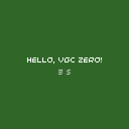<br>Hello World](#hello-world)
[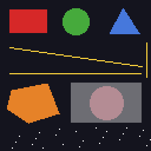<br>Shapes](#shapes)
[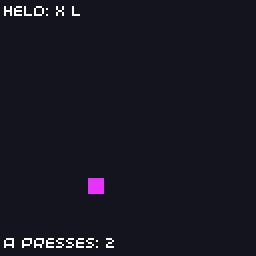<br>Input](#input)
[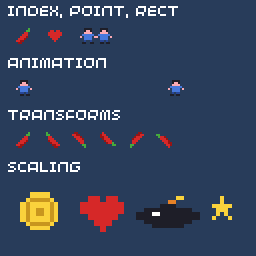<br>Sprites](#sprites)
[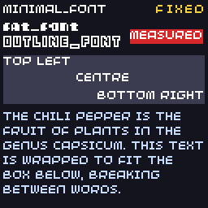<br>Text](#text)
[<br>Audio](#audio)
[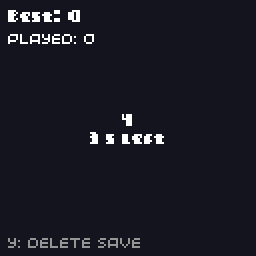<br>Saves](#saves)
[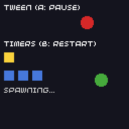<br>Timers and Tweens](#timers-tweens)
[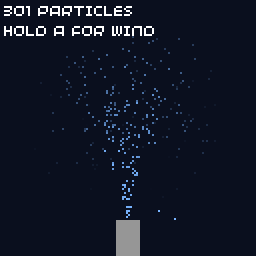<br>Particles](#particles)
[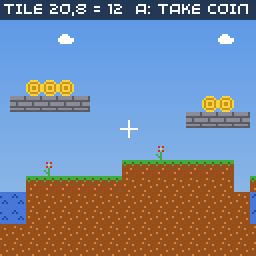<br>Tile Map](#tilemap)
[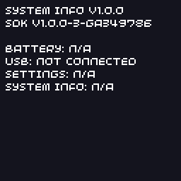<br>System Info](#system-info)
[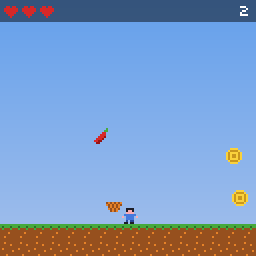<br>Chili Catch](#chili-catch)
</div>

## Building them

```bash
cmake -B build.examples -S docs/examples
cmake --build build.examples
./build.examples/chili-catch/chili-catch
```

See [building the examples](../tutorials/index.md#building-the-examples) for console builds.

The older and larger [32blit examples](https://github.com/32blit/32blit-examples) also build with this SDK. They were written for the 32blit's 320×240 screen, so most don't fit the VGC Zero's 128×128 one, but they are a good source of techniques. Some of them run [in your browser](https://sdk.chilichip.eu/web-examples/).

## Hello World { #hello-world }

{ .screenshot align=right }

The smallest complete game: text and a colour cycle.

Explained in: [the tutorial](../tutorials/game-loop.md)

??? example "hello-world.cpp"

    ```cpp
    --8<-- "hello-world/hello-world.cpp"
    ```

## Shapes { #shapes }

{ .screenshot align=right }

Every drawing primitive: rectangles, circles, triangles, lines, polygons, pixels and transparency.

Explained in: [the tutorial](../tutorials/game-loop.md#drawing-shapes)

??? example "shapes.cpp"

    ```cpp
    --8<-- "shapes/shapes.cpp"
    ```

## Input { #input }

{ .screenshot align=right }

Move a square with the d-pad, react to presses and releases, and list the held buttons.

Explained in: [the tutorial](../tutorials/input.md)

??? example "input.cpp"

    ```cpp
    --8<-- "input/input.cpp"
    ```

## Sprites { #sprites }

{ .screenshot align=right }

Draw sprites by index, cell or block; animate them; flip, rotate and scale them.

Explained in: [the tutorial](../tutorials/sprites.md)

??? example "sprites.cpp"

    ```cpp
    --8<-- "sprites/sprites.cpp"
    ```

## Text { #text }

{ .screenshot align=right }

The built-in fonts, fixed width, alignment, measuring and wrapping.

Explained in: [the tutorial](../tutorials/text.md)

??? example "text.cpp"

    ```cpp
    --8<-- "text/text.cpp"
    ```

## Audio { #audio }

{ .screenshot align=right }

Four synth channels with different waveforms and envelopes, played from the buttons.

Explained in: [the tutorial](../tutorials/sound.md)

??? example "audio.cpp"

    ```cpp
    --8<-- "audio/audio.cpp"
    ```

## Saves { #saves }

{ .screenshot align=right }

A five-second button-mashing game that keeps your best score with read_save, write_save and on_quit.

Explained in: [the tutorial](../tutorials/saving.md)

??? example "saves.cpp"

    ```cpp
    --8<-- "saves/saves.cpp"
    ```

## Timers and Tweens { #timers-tweens }

{ .screenshot align=right }

Repeating and counted timers, and tweens that slide and bob.

Explained in: [the tutorial](../tutorials/animation.md)

??? example "timers-tweens.cpp"

    ```cpp
    --8<-- "timers-tweens/timers-tweens.cpp"
    ```

## Particles { #particles }

{ .screenshot align=right }

A water fountain made with ParticleGenerator, with wind on A.

Explained in: [the tutorial](../tutorials/animation.md#particles)

??? example "particles.cpp"

    ```cpp
    --8<-- "particles/particles.cpp"
    ```

## Tile Map { #tilemap }

{ .screenshot align=right }

A scrolling level built from text, with coins you can collect.

Explained in: [the tutorial](../tutorials/tilemaps.md)

??? example "tilemap.cpp"

    ```cpp
    --8<-- "tilemap/tilemap.cpp"
    ```

## System Info { #system-info }

{ .screenshot align=right }

Battery, USB, the player's settings and firmware details from the system API.

Explained in: [System API](../api/system.md)

??? example "system-info.cpp"

    ```cpp
    --8<-- "system-info/system-info.cpp"
    ```

## Chili Catch { #chili-catch }

{ .screenshot align=right }

A complete game: catch chilis, dodge bombs, beat your best score.

Explained in: [the tutorial](../tutorials/complete-game.md)

??? example "chili-catch.cpp"

    ```cpp
    --8<-- "chili-catch/chili-catch.cpp"
    ```
