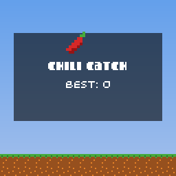

# 9. Make a complete game

<div class="gallery" markdown>


</div>

**Chili Catch** is a small but complete game that uses everything from the earlier lessons. Chilis fall from the sky and you catch them in a basket: chilis are worth 1 point, coins 5, hearts give you a life back, and bombs take one away. Everything falls faster as your score goes up, and your best score is saved.

It's about 330 lines in one file, [`docs/examples/chili-catch/chili-catch.cpp`](https://github.com/chili-chip/32blit-sdk/blob/master/docs/examples/chili-catch/chili-catch.cpp). This page walks through it section by section; the [full source](#full-source) is at the end.

## Game states

A game is usually in one of a few **states**: a title screen, playing, paused, game over. Keeping the state in one variable and switching on it keeps each part of the code simple.

```cpp
--8<-- "chili-catch/chili-catch.cpp:state"
```

* `Item` is anything falling: which sprite it is, where it is, and how fast it falls.
* `Spark` is one particle of a burst.
* `SaveData` holds the best score, with a version number as in [Saving progress](saving.md).
* The rest is the state of the current round: the player's position, the falling items, the score, lives, and when to spawn the next item.

## Sound

Each kind of sound gets its own channel, set up once. Every effect has `sustain = 0` so it ends by itself.

```cpp
--8<-- "chili-catch/chili-catch.cpp:sound"
```

## Starting, ending and spawning

```cpp
--8<-- "chili-catch/chili-catch.cpp:helpers"
```

* `start_game()` resets the round. `end_game()` checks for a new best and saves straight away, because the player might switch the console off on the game over screen.
* `spawn_item()` rolls a random number to decide what falls. 63% of items are chilis, 12% coins, 22% bombs and 3% hearts. Changing these numbers changes how the game feels more than almost anything else.
* Difficulty comes from two numbers that grow with the score: how fast items fall, and how long until the next one. Both are capped with `std::min` so the game stays playable.

## Init

```cpp
--8<-- "chili-catch/chili-catch.cpp:init"
```

This loads the spritesheet, loads the save and registers `save_best` as `on_quit`, sets up the sound channels, and starts the tween that makes the title bob up and down.

## Update: playing

```cpp
--8<-- "chili-catch/chili-catch.cpp:playing"
```

* Movement uses held buttons and a fixed speed per update, and clamps the player to the screen.
* Collision is a rectangle test: `Rect::intersects()` between each item and the basket's rectangle.
* Items are removed from the vector while looping over it. `erase()` returns the next iterator, which is the safe way to do that.

## Update: every state

```cpp
--8<-- "chili-catch/chili-catch.cpp:update"
```

`update()` hands over to the right code for the current state. On the title and game over screens, A starts a new round.

### Sparks

The sparks are updated in every state so a burst finishes even after the game ends. Each spark is a position and velocity with a bit of gravity, removed after 600 ms with the erase-remove idiom. This is the simple alternative to a [`ParticleGenerator`](animation.md#particles) for one-off bursts.

## Render

```cpp
--8<-- "chili-catch/chili-catch.cpp:render"
```

Drawing goes back to front: sky, ground, falling items, the player, sparks, and then either the HUD or a title or game over panel on top.

* The sky is a gradient of horizontal spans, one per line.
* The player sprite is flipped with `SpriteTransform::HORIZONTAL` when facing left, and the basket moves to that side.
* After a bomb, the player flashes by skipping their drawing on alternate 80 ms periods.
* Spark colour fades with age through the pen's alpha.
* The panels use a translucent black rectangle so the game shows through.

## Ideas to extend it

* **Pause menu:** a `paused` state entered with MENU, drawn as another panel.
* **Combos:** count chilis caught in a row and give a bonus every ten.
* **Music:** a looping tune on a spare channel, using a [Timer](animation.md#timers) to step through notes.
* **Power-ups:** a star that makes the basket wider for ten seconds, with a Timer to end it.
* **Statistics:** total chilis caught across all games, kept in `SaveData` (remember to bump `version`).

## Full source

??? example "chili-catch.cpp"

    ```cpp
    --8<-- "chili-catch/chili-catch.cpp"
    ```

Build it with the other examples, or copy it into a project made from the template along with `docs/examples/shared/sprites.png`, and put it on your console. Have fun.
