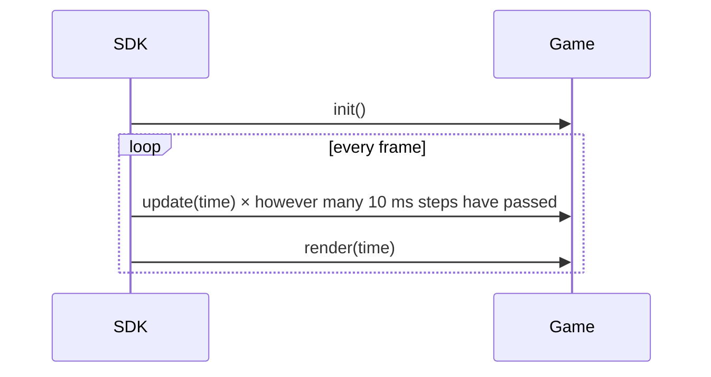

# 1. The game loop

Every game is built around three functions that the SDK calls for you. This lesson explains what each one is for, how the screen works, and how to draw on it.

## Hello, VGC Zero

{ .screenshot align=right }

Here is the smallest complete game. It fades the background through the colours of the rainbow and shows how long it has been running.

```cpp title="hello-world.cpp"
--8<-- "hello-world/hello-world.cpp"
```

## `init`, `update` and `render`

You don't write a `main()` function. The SDK has one, and it calls yours:

`void init()`
:   Called **once** when the game starts. Load your assets, set the screen mode and set up your starting state here.

`void update(uint32_t time)`
:   Called **100 times a second**, every 10 ms, whatever the frame rate. Read input, move things and run your game logic here. Because the rate is fixed, you can move things by a fixed amount per update: 1 pixel per update is always 100 pixels a second.

`void render(uint32_t time)`
:   Called **once per frame**, as fast as the screen can be refreshed. Draw everything here, and don't change the game's state: render may run more or less often than update.

`time` is the number of milliseconds since the game started. It's the same clock as `blit::now()`.



If a frame takes 25 ms to draw, the SDK calls `update()` two or three times before the next `render()` to catch up, so the game runs at the same speed even when the frame rate drops.

!!! tip "Keep logic in `update`, drawing in `render`"
    It's tempting to move things in `render()`, but then your game runs faster on a fast screen and slower on a slow one. Anything that changes state belongs in `update()`.

## The screen

`screen` is a [`Surface`](../api/surface.md): a block of pixels with a current colour (`pen`) and functions to draw on it. What you draw in `render()` is shown when it returns.

The VGC Zero's display is 128×128 pixels. Pick how much of it to use with `set_screen_mode()`, normally in `init()`:

| Mode | Size | Notes |
| ---- | ---- | ----- |
| `ScreenMode::lores` | 64×64 | every pixel is shown as 2×2; the default |
| `ScreenMode::hires` | 128×128 | the whole screen at full detail |

There is also `ScreenMode::hires_palette`, an 8-bit paletted mode, but the VGC Zero's display doesn't support it; stick to `lores` and `hires`.

Coordinates start at the top-left corner, `(0, 0)`, with `x` to the right and `y` down. In `hires` the bottom-right pixel is `(127, 127)`. Use `screen.bounds.w` and `screen.bounds.h` rather than hard-coding the size if your game might run in more than one mode.

## Colours

Set `screen.pen` to a [`Pen`](../api/surface.md#pen) before drawing. A pen is red, green, blue and alpha (opacity), each 0–255:

```cpp
screen.pen = Pen(255, 0, 0);          // red
screen.pen = Pen(255, 255, 255, 128); // half-transparent white
screen.pen = hsv_to_rgba(0.33f, 1.0f, 1.0f); // hue, saturation, value, each 0-1: green
```

Everything you draw uses the current pen until you change it.

## Drawing shapes

{ .screenshot align=right }

The `shapes` example draws every primitive the SDK has:

```cpp title="shapes.cpp"
--8<-- "shapes/shapes.cpp"
```

| Call | Draws |
| ---- | ----- |
| `clear()` | fills the whole surface (inside the clip rectangle) |
| `pixel(p)` | one pixel |
| `rectangle(r)` | a filled rectangle |
| `circle(centre, radius)` | a filled circle |
| `line(p1, p2)` | a one-pixel line |
| `h_span(p, length)`, `v_span(p, length)` | fast horizontal and vertical lines |
| `triangle(p1, p2, p3)` | a filled triangle |
| `polygon(points)` | a filled polygon |

Positions are [`Point`](../api/types.md#point)s (whole-pixel `x`, `y`) and areas are [`Rect`](../api/types.md#rect)s (`x`, `y`, `w`, `h`).

### Transparency

A pen's alpha blends what you draw with what's already there: 255 is solid, 0 is invisible. `screen.alpha` multiplies every drawing operation's alpha, which is useful for fading a whole group of things in or out. Remember to set it back to 255 afterwards.

### Clipping

`screen.clip` is a rectangle that limits all drawing. Set it to draw only inside a window, and set it back to the full screen afterwards:

```cpp
screen.clip = Rect(10, 10, 50, 50);
screen.pen = Pen(255, 0, 0);
screen.clear();                       // only fills 10,10 to 60,60
screen.clip = Rect(Point(0, 0), screen.bounds);
```

## Time

| Function | Returns |
| -------- | ------- |
| `now()` | milliseconds since the game started |
| `now_us()` | microseconds, for timing short pieces of code |
| `us_diff(from, to)` | microseconds between two `now_us()` values, handling wrap-around |

For anything that happens after a delay or repeats, a [Timer](animation.md#timers) is tidier than comparing times yourself.

## Random numbers

`blit::random()` returns a random 32-bit number. Use `%` to bring it into range:

```cpp
int x = blit::random() % 128;  // 0 to 127
```

Always write `blit::random()` in full. With `using namespace blit`, a bare `random()` is ambiguous with the C library's function of the same name, and the code won't compile on Linux.

## Try it

* Change the hello world message, and use `fat_font` instead of `minimal_font`.
* Draw a sun in the top corner of `shapes` with a circle and eight lines around it.
* Make the starfield in `shapes` move twice as fast.

Next: [reading input](input.md).
