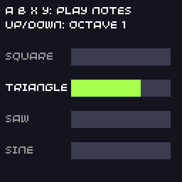

# 5. Sound

{ .screenshot align=right }

The SDK has a built-in synthesiser with 8 channels. Each channel plays a note with a waveform and an envelope, which is plenty for sound effects and chiptune music. Channels can also play WAV and MP3 files.

```cpp title="audio.cpp"
--8<-- "audio/audio.cpp"
```

## Channels

`channels[0]` to `channels[7]` are the eight voices. Each one is an [`AudioChannel`](../api/audio.md#audiochannel) that you set up once, usually in `init()`, then trigger whenever you want a sound:

```cpp
channels[0].waveforms = Waveform::SQUARE;
channels[0].frequency = 880;     // Hz
channels[0].trigger_attack();    // start the note
```

## Waveforms

| Waveform | Sound |
| -------- | ----- |
| `SQUARE` | hollow and buzzy, the classic chiptune sound; `pulse_width` changes its tone |
| `TRIANGLE` | soft and flute-like |
| `SAW` | bright and harsh |
| `SINE` | pure and smooth |
| `NOISE` | hiss, for explosions, drums and wind |
| `WAVE` | your own samples, from a callback (this is how WAV and MP3 playback work) |

They are bit flags, so you can mix several on one channel: `Waveform::SQUARE | Waveform::NOISE`.

## Envelopes

Each note follows an ADSR envelope:

```
volume
  ▲     ┌─ decay
  │    /\
  │   /  \_________  ← sustain level
  │  /             \
  │ /               \  ← release
  └──────────────────────► time
   attack        trigger_release()
```

| Field | Meaning |
| ----- | ------- |
| `attack_ms` | time to rise to full volume |
| `decay_ms` | time to fall to the sustain level |
| `sustain` | the level held until the note is released, `0` to `0xffff` |
| `release_ms` | time to fade to silence after `trigger_release()` |

* For **sound effects** that end by themselves, set `sustain = 0`. The note rises, decays to silence and stops; you never need to release it.
* For **held notes**, set a sustain level, call `trigger_attack()` when the note starts and `trigger_release()` when it ends.

`channels[n].volume` sets a channel's loudness (`0` to `0xffff`). The player's volume setting on the console is applied on top, so leave room in your mix rather than turning everything up to full.

## Sound effects

A small function that sets a frequency and triggers is all most games need:

```cpp
void play(int channel, uint16_t frequency) {
  channels[channel].frequency = frequency;
  channels[channel].trigger_attack();
}

// a coin pickup: a short high blip
play(0, 1320);
```

Give each kind of sound its own channel so a new explosion doesn't cut off the coin sound. For a rising or falling effect, change `frequency` in `update()` while the note plays.

## Music files

`WavStream` and `MP3Stream` play a file on one channel, reading it a little at a time.

* **WAV** files must be uncompressed PCM, mono, at 22 050 or 11 025 Hz.
* **MP3** files are best at 22 050 Hz mono; other rates and stereo are converted, but roughly.

The simplest way to ship music is to pack the file into your game as raw data and register it as an in-memory file:

```yaml title="assets.yml"
assets.cpp:
  assets/music.mp3:
    name: asset_music
    type: raw/binary
```

```cpp
#include "assets.hpp"

MP3Stream music;

void init() {
  File::add_buffer_file("music.mp3", asset_music, asset_music_length);
  music.load("music.mp3");
  music.play(7, MP3Stream::loop);  // loop on channel 7
}

void update(uint32_t time) {
  music.update();  // keep the decoder fed
}
```

Call `update()` on the stream every update: it decodes the next part of the file. MP3 decoding takes noticeable CPU time on the console, so prefer WAV (or the synthesiser) when a game is short of time, and keep files small: they count towards the 12 MB of flash for games. See [Audio](../api/audio.md#wavstream-and-mp3stream).

## Try it

* Add a fifth note on MENU with `Waveform::NOISE` as a drum.
* Make a "power up" sound: start at 400 Hz and raise `frequency` by 20 every update for half a second.
* Play a short tune by stepping through an array of notes with a [Timer](animation.md#timers).

Next: [saving progress](saving.md).
